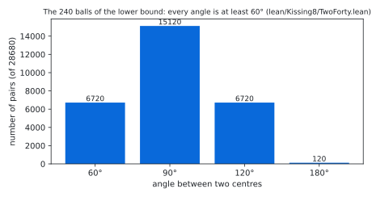
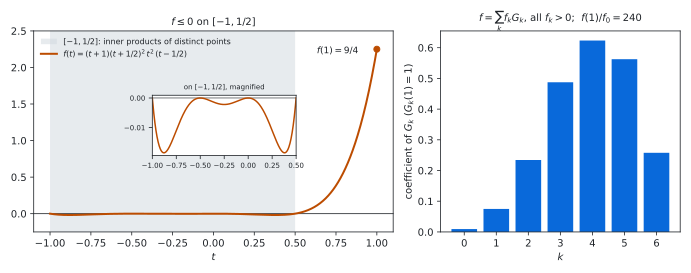
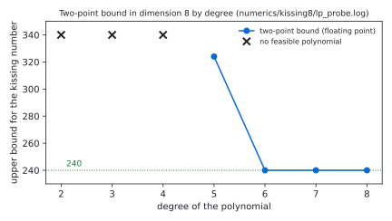

# The kissing number in dimension 8: a Lean 4 formalisation of the two-point bound

[](https://doi.org/10.5281/zenodo.23368500)

Status: **Lean 4 formalisation, not peer reviewed.** Prepared 2026-10-13. **Produced by AI models** under the direction
of the repository owner; see [`AI_DISCLOSURE.md`](AI_DISCLOSURE.md).

> [!IMPORTANT]
> This repository is a public, timestamped, AI-produced **warrant** for a Lean 4 proof that the kissing number in
> dimension 8 is 240, a theorem of V. I. Levenshtein (Soviet Math. Dokl. 20 (1979)) and of A. M. Odlyzko and
> N. J. A. Sloane (J. Combin. Theory Ser. A 26 (1979)): a machine-checked argument that no human has yet digested. The
> theorem was settled in 1979; we do not regard this formal argument as settled until it has been checked
> independently.
> Independent verification and human-readable expositions are welcome, and credit for a human-readable proof belongs
> to whoever writes one. To refer to the computational result, please cite the archived repository
> ([10.5281/zenodo.23368500](https://doi.org/10.5281/zenodo.23368500)). Questions, checks and corrections:
> [GitHub issues](https://github.com/alejandrozarco/kissing-number-8/issues).

Archived on Zenodo: [10.5281/zenodo.23368500](https://doi.org/10.5281/zenodo.23368500) (all versions).
Cite with `CITATION.cff`.

The kissing number $`\kappa(d)`$ is the largest number of non-overlapping unit balls in $`\mathbb{R}^d`$ that touch a
common unit ball. `lean/Kissing8/Statement.lean` states, and the Lean kernel checks in `lean/Kissing8/Solution.lean`:

```math
\kappa(8) = 240 .
```

The lower bound uses 240 points with integer coordinates (a copy of the root system of $`E_8`$). The upper bound is the
two-point (Delsarte) bound with the polynomial of Levenshtein and of Odlyzko and Sloane; the positivity of the
Gegenbauer kernels of the sphere $`S^7`$ that it needs is proved in Lean, one dimension at a time. The Lean package
depends on Mathlib only.

## The statement

```lean
abbrev E (d : ℕ) := EuclideanSpace ℝ (Fin d)

def IsKissing {d : ℕ} (S : Set (E d)) : Prop :=
  (∀ x ∈ S, ‖x‖ = 2) ∧ ∀ x ∈ S, ∀ y ∈ S, x ≠ y → 2 ≤ dist x y

noncomputable def kissingNumber (d : ℕ) : ℕ∞ :=
  ⨆ (S : Set (E d)) (_ : IsKissing S), S.encard

theorem exists_isKissing_encard_eq_twoHundredForty : ∃ S : Set (E 8), IsKissing S ∧ S.encard = 240
theorem encard_le_twoHundredForty_of_isKissing (S : Set (E 8)) (hS : IsKissing S) : S.encard ≤ 240
theorem kissingNumber_eight : kissingNumber 8 = 240
```

`IsKissing S` says that the points of `S` are centres of unit balls that touch the unit ball at the origin (distance
2) and do not overlap each other (pairwise distance at least 2). Sets may be infinite; sizes are counted in `ℕ∞`.
Three further theorems test the definition: two opposite balls form an arrangement, two balls $`30^\circ`$ apart do
not, and a ball at distance 3 does not. The definitions are those of
[kissing-number-3](https://github.com/alejandrozarco/kissing-number-3) and
[kissing-number-4](https://github.com/alejandrozarco/kissing-number-4) with $`d = 8`$;
[`lean/STATEMENT.md`](lean/STATEMENT.md) explains every line.

Checks recorded in [`verification/`](verification/):
- Comparator: the six theorems of `lean/comparator.json` have the statements of `lean/Kissing8/Statement.lean`, use
  only the axioms `propext`, `Quot.sound`, `Classical.choice`, and are accepted by the Lean kernel.
- `#print axioms` for all six: `[propext, Classical.choice, Quot.sound]`.
- A clean build of all modules, one at a time from a fresh copy, with wall time and peak memory (table below).

The files contain no `sorry` outside `Statement.lean` and no `native_decide`.

## The argument

Any arrangement with more than 240 balls contains 241. Halving their centres gives unit vectors
$`x_1, \dots, x_{241}`$ in $`\mathbb{R}^8`$ with $`\langle x_i, x_j \rangle \le 1/2`$ for $`i \ne j`$. Let

```math
f(t) = (t+1)\,(t+\frac{1}{2})^2\,t^2\,(t-\frac{1}{2}) = \sum_{k=0}^{6} f_k\, G_k(t),
```

where $`G_k`$ is the Gegenbauer polynomial of $`S^7`$ with $`G_k(1) = 1`$. All $`f_k`$ are positive, $`f_0 = 3/320`$
and $`f(1) = 9/4`$. For unit vectors $`x_1, \dots, x_N`$ with pairwise inner products in $`[-1, 1/2]`$, where
$`f \le 0`$,

```math
\frac{3}{320}\, N^2 \;\le\; \sum_{k=0}^{6} f_k \sum_{i,j} G_k(\langle x_i, x_j \rangle) \;=\; \sum_{i,j} f(\langle x_i, x_j \rangle) \;\le\; N\, f(1) = \frac{9}{4}\, N ,
```

because every kernel $`G_k(\langle x, y \rangle)`$ is positive semidefinite on $`S^7`$. Hence $`N \le 240`$.

Positive semidefiniteness is proved for degrees $`k \le 6`$ by induction on the dimension. In the solid form
$`Z^{(d)}_k(x, x') = \lVert x\rVert^k \lVert x'\rVert^k\, C_k(\langle x, x'\rangle / \lVert x\rVert \lVert x'\rVert)`$ (a polynomial in
$`\langle x, x' \rangle`$, $`\lVert x\rVert^2`$, $`\lVert x'\rVert^2`$), the kernel of $`\mathbb{R}^{d}`$ splits along the first coordinate,
$`x = (a, y)`$, as a nonnegative combination of products $`B(a, \lVert x\rVert^2)\, B(a', \lVert x'\rVert^2)\, Z^{(d-1)}_m(y, y')`$ of
kernels of $`\mathbb{R}^{d-1}`$. Starting from $`\mathbb{R}^2`$, where $`Z^{(2)}_m`$ is the real part of
$`(y_0 + i y_1)^m (y'_0 - i y'_1)^m`$ and positivity is a squared modulus, this reaches $`\mathbb{R}^8`$ in six steps with
42 polynomial identities, each generated and checked with sympy and proved in Lean by `ring`.

| Lean module | content |
|---|---|
| `Kissing8/Kernel.lean` | the kernels, the positivity predicate, the base case on $`\mathbb{R}^2`$ and the induction step |
| `Kissing8/Addition3.lean` … `Addition8.lean` | the 42 splitting identities (generated by `lean/gen/gen_addition8.py`) |
| `Kissing8/Positivity.lean` | positivity of the Gegenbauer kernels of $`\mathbb{R}^3, \dots, \mathbb{R}^8`$ for $`k \le 6`$ |
| `Kissing8/Delsarte.lean` | the polynomial $`f`$, its expansion, its sign on $`[-1, 1/2]`$, and the bound $`N \le 240`$ |
| `Kissing8/TwoForty.lean` | the 240 points: integer coordinates, norm exactly 2, pairwise distance at least 2 (generated by `lean/gen/gen_twoforty.py`) |
| `Kissing8/Solution.lean` | the statements of `Kissing8/Statement.lean`, with proofs |

The 240 points are the vectors of norm 2 in Construction A of the extended Hamming code $`[8, 4, 4]`$: the 16 vectors
$`\pm 2 e_i`$ and the 224 vectors with entries $`\pm 1`$ on the support of one of the 14 codewords of weight 4. This set is
an isometric copy of the 240 roots of $`E_8`$ scaled by $`\sqrt{2}`$.

## Figures

Regenerate with `python3 figures/make_figures.py` (matplotlib 3.9.4, numpy); every figure is computed from repository
files only.

<picture>
  <source media="(prefers-color-scheme: dark)" srcset="figures/angles_dark.svg">
  
</picture>

The 28680 angles between the 240 centres of the lower bound (`lean/Kissing8/TwoForty.lean`), seen from the origin.
Two balls touching the central ball overlap exactly when their angle is below $`60^\circ`$; here 6720 pairs touch.

<picture>
  <source media="(prefers-color-scheme: dark)" srcset="figures/polynomial_dark.svg">
  
</picture>

The polynomial of the upper bound (`lean/Kissing8/Delsarte.lean`) and its coefficients $`f_k`$ in the Gegenbauer
polynomials $`G_k`$ of $`S^7`$.

<picture>
  <source media="(prefers-color-scheme: dark)" srcset="figures/degree_dark.svg">
  
</picture>

The floating-point two-point bound by the degree of the polynomial (`numerics/kissing8/lp_probe.log`, not certified):
degree 6 is the smallest that gives 240.

## Contents

| path | content |
|---|---|
| `lean/` | the Lean package: statement, proof, generators (`gen/`), Comparator config, build and Comparator scripts |
| `lean/STATEMENT.md` | the statement in plain English |
| `numerics/kissing8/` | exact checks of the identities, the coefficients and the 240 points; the floating-point bound by degree |
| `verification/` | records of the clean build, Comparator and axioms |
| `figures/` | the figures and `make_figures.py` |
| `formalization.yaml` | metadata (mathlib-initiative format v0.4) |
| `AI_DISCLOSURE.md` | how AI models were used, what is checked and what is trusted |
| `LICENSE`, `CITATION.cff` | licence (Apache-2.0) and citation metadata |
| `MANIFEST.sha256` | sha256 of every file |

## Reproduce

Lean (toolchain `leanprover/lean4:v4.34.1`, Mathlib `d13f23b`, both pinned):

```sh
cd lean
lake exe cache get
bash scripts/build_test.sh          # every module one at a time (or: lake build)
lake env lean Kissing8/Axioms.lean
bash scripts/run_comparator.sh      # Comparator; builds the pinned tools of scripts/tools.sh if needed
```

Generators and exact checks (Python 3, `sympy`; `scipy` only for `lp_probe.py`):

```sh
python3 lean/gen/gen_addition8.py /tmp/out    # regenerate the identities (checked with sympy first)
python3 lean/gen/gen_twoforty.py /tmp/T.lean   # regenerate the 240 points (checked first)
cd numerics/kissing8
python3 addition8_probe.py                     # the 42 identities: coefficients and their signs
python3 delsarte8_probe.py                     # the coefficients of f, f(1)/f_0 = 240, the 240 points
python3 lp_probe.py                            # exact certificates in dimensions 8 and 24; float bound by degree
```

## Clean build

The 13 modules reachable from the build roots `Kissing8.Statement`, `Kissing8.Solution` and
`Kissing8.Axioms`, each compiled one at a time (`lean/scripts/build_test.sh`, `lean -j1`) from a fresh copy of
`lean/` after `lake exe cache get`, on Linux x86_64 (`verification/build_test.tsv`). Wall time includes loading
Mathlib for each module. Memory in GiB ($`2^{30}`$ bytes).

| module | wall (s) | peak RSS (GiB) |
|---|---:|---:|
| `Kissing8.Statement` | 52 | 6.53 |
| `Kissing8.TwoForty` | 276 | 7.22 |
| `Kissing8.Kernel` | 36 | 6.54 |
| `Kissing8.Addition3` | 34 | 6.63 |
| `Kissing8.Addition4` | 30 | 6.63 |
| `Kissing8.Addition5` | 29 | 6.64 |
| `Kissing8.Addition6` | 33 | 6.64 |
| `Kissing8.Addition7` | 35 | 6.64 |
| `Kissing8.Addition8` | 31 | 6.64 |
| `Kissing8.Positivity` | 18 | 6.55 |
| `Kissing8.Delsarte` | 22 | 6.57 |
| `Kissing8.Solution` | 21 | 6.56 |
| `Kissing8.Axioms` | 15 | 6.51 |

Total 11 min; largest peak 7.22 GiB (`Kissing8.TwoForty`).

## Related work

- V. I. Levenshtein, *On bounds for packings in n-dimensional Euclidean space*, Soviet Math. Dokl. 20 (1979);
  A. M. Odlyzko and N. J. A. Sloane, *New bounds on the number of unit spheres that can touch a unit sphere in n
  dimensions*, J. Combin. Theory Ser. A 26 (1979). The polynomial used here is theirs.
- P. Delsarte, J.-M. Goethals and J. J. Seidel, *Spherical codes and designs*, Geom. Dedicata 6 (1977) (the linear
  programming bound); E. Bannai and N. J. A. Sloane, *Uniqueness of certain spherical codes*, Canad. J. Math. 33
  (1981).
- [math-inc/Sphere-Packing-Lean](https://github.com/math-inc/Sphere-Packing-Lean) formalises sphere packing in
  dimensions 8 and 24, including the $`E_8`$ lattice and, in dimension 24, the two-point bound $`196560`$, the Leech
  lattice and the uniqueness of the kissing configuration. No code from it is used here; we did not find the
  dimension-8 kissing bound there.
- [kissing-number-3](https://github.com/alejandrozarco/kissing-number-3) and
  [kissing-number-4](https://github.com/alejandrozarco/kissing-number-4): the same statement for $`d = 3, 4`$, by
  three-point certificates. We did not find another formal proof of $`\kappa(8) = 240`$; please tell us if one exists.

## Licence

Apache License 2.0 ([`LICENSE`](LICENSE)), copyright 2026 the repository owner (alejandrozarco).
